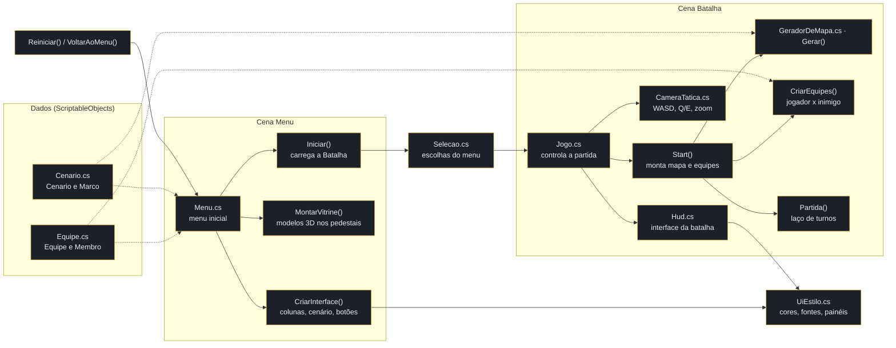
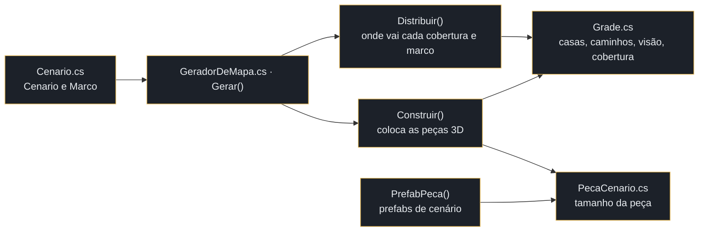
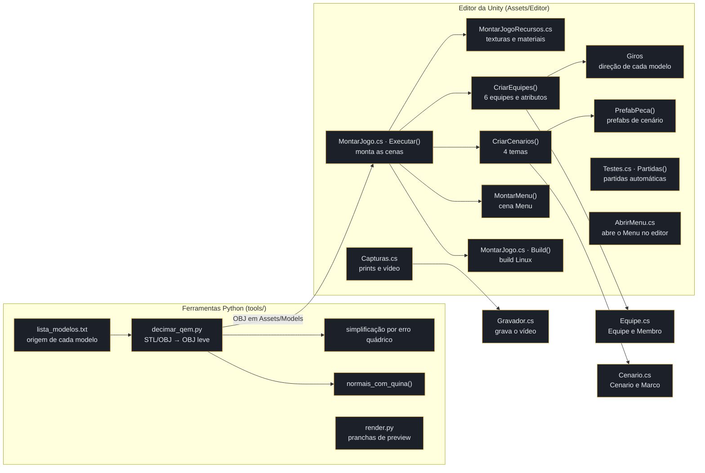

# Mapa do código: Kill Team Tático

Cada caixa dos diagramas abre o arquivo no **VS Code**, já na linha da função.

**Como usar no VS Code:**

1. Abra este arquivo e aperte `Ctrl+Shift+V`. O clique só funciona no *preview*, não no texto do arquivo.
2. Para os diagramas aparecerem desenhados, instale uma vez a extensão *Markdown Preview Mermaid Support*: `code-oss --install-extension bierner.markdown-mermaid`, ou procure por "Markdown Preview Mermaid" na aba de extensões.
3. Sem a extensão, use a tabela **Todos os arquivos** no fim: cada link abre o arquivo na linha certa.

**No navegador:** abra `MAPA_DO_CODIGO.html`, que já desenha os diagramas. Ao clicar, o navegador e o VS Code pedem confirmação. Marque *Allow opening local paths without asking*.

Para gerar de novo (se o projeto mudar de pasta ou o código mudar de linha), rode `python3 tools/gerar_mapa.py`. O HTML usa o protocolo `code-oss://`; para o VS Code oficial, rode `python3 tools/gerar_mapa.py vscode`.

## Visão geral: as duas cenas

## Fluxo de uma partida

```mermaid
flowchart TD
    d2_partida --> d2_turnoJ
    d2_partida --> d2_turnoI
    d2_turnoJ --> d2_update
    d2_turnoJ --> d2_botao
    d2_update --> acoes
    d2_botao --> acoes
    d2_turnoI --> d2_ia
    d2_ia --> acoes
    subgraph acoes["Ações de cada soldado"]
        d2_mover
        d2_atirar
        d2_vigiar
        d2_defender
        d2_curar
    end
    d2_mover --> d2_unidade
    d2_mover --> d2_vigiar
    d2_atirar --> d2_chance
    d2_chance --> d2_grade
    d2_atirar --> d2_projetil
    d2_projetil --> d2_autodestruir
    d2_atirar --> d2_unidade
    d2_atirar --> d2_pontos
    d2_curar --> d2_pontos
    d2_pontos --> d2_hud
    d2_partida --> d2_fimJogo
    d2_criarEq --> d2_criarUn
    d2_criarUn --> d2_unidade
    d2_unidade --> d2_halo
    d2_unidade --> d2_billboard

    d2_criarEq["CriarEquipes()<br/>jogador x inimigo"]
    d2_criarUn["CriarUnidade()<br/>modelo, atributos, escala"]
    d2_partida["Partida()<br/>laço de turnos"]
    d2_turnoJ["TurnoJogador()"]
    d2_turnoI["TurnoInimigo()"]
    d2_update["Update()<br/>teclado e mouse"]
    d2_botao["BotaoAcao()<br/>botões da HUD"]
    d2_mover["Mover()"]
    d2_atirar["Atirar()"]
    d2_chance["Chance()<br/>mira, cobertura, flanco"]
    d2_vigiar["Vigiar() e Vigilancias()<br/>tiro de reação"]
    d2_defender["Defender()"]
    d2_curar["Curar()"]
    d2_fimJogo["Reiniciar() / VoltarAoMenu()"]
    d2_ia["IA.cs · Agir()<br/>decisão do inimigo"]
    d2_grade["Grade.cs<br/>casas, caminhos, visão, cobertura"]
    d2_unidade["Unidade.cs<br/>andar, recuo, morrer"]
    d2_projetil["Projetil.cs<br/>Rigidbody, Trail, OnTriggerEnter"]
    d2_halo["HaloPulsante.cs"]
    d2_billboard["Billboard.cs"]
    d2_autodestruir["AutoDestruir.cs"]
    d2_hud["Hud.cs<br/>interface da batalha"]
    d2_pontos["Pontuacao.cs<br/>placar e legenda"]
    click d2_criarEq href "Assets/Scripts/Jogo.cs#L91" "Abrir Assets/Scripts/Jogo.cs:91" _self
    click d2_criarUn href "Assets/Scripts/Jogo.cs#L133" "Abrir Assets/Scripts/Jogo.cs:133" _self
    click d2_partida href "Assets/Scripts/Jogo.cs#L214" "Abrir Assets/Scripts/Jogo.cs:214" _self
    click d2_turnoJ href "Assets/Scripts/Jogo.cs#L239" "Abrir Assets/Scripts/Jogo.cs:239" _self
    click d2_turnoI href "Assets/Scripts/Jogo.cs#L269" "Abrir Assets/Scripts/Jogo.cs:269" _self
    click d2_update href "Assets/Scripts/Jogo.cs#L290" "Abrir Assets/Scripts/Jogo.cs:290" _self
    click d2_botao href "Assets/Scripts/Jogo.cs#L415" "Abrir Assets/Scripts/Jogo.cs:415" _self
    click d2_mover href "Assets/Scripts/Jogo.cs#L599" "Abrir Assets/Scripts/Jogo.cs:599" _self
    click d2_atirar href "Assets/Scripts/Jogo.cs#L628" "Abrir Assets/Scripts/Jogo.cs:628" _self
    click d2_chance href "Assets/Scripts/Jogo.cs#L576" "Abrir Assets/Scripts/Jogo.cs:576" _self
    click d2_vigiar href "Assets/Scripts/Jogo.cs#L707" "Abrir Assets/Scripts/Jogo.cs:707" _self
    click d2_defender href "Assets/Scripts/Jogo.cs#L716" "Abrir Assets/Scripts/Jogo.cs:716" _self
    click d2_curar href "Assets/Scripts/Jogo.cs#L725" "Abrir Assets/Scripts/Jogo.cs:725" _self
    click d2_fimJogo href "Assets/Scripts/Jogo.cs#L743" "Abrir Assets/Scripts/Jogo.cs:743" _self
    click d2_ia href "Assets/Scripts/IA.cs#L8" "Abrir Assets/Scripts/IA.cs:8" _self
    click d2_grade href "Assets/Scripts/Grade.cs#L5" "Abrir Assets/Scripts/Grade.cs:5" _self
    click d2_unidade href "Assets/Scripts/Unidade.cs#L6" "Abrir Assets/Scripts/Unidade.cs:6" _self
    click d2_projetil href "Assets/Scripts/Projetil.cs#L6" "Abrir Assets/Scripts/Projetil.cs:6" _self
    click d2_halo href "Assets/Scripts/HaloPulsante.cs#L4" "Abrir Assets/Scripts/HaloPulsante.cs:4" _self
    click d2_billboard href "Assets/Scripts/Billboard.cs#L4" "Abrir Assets/Scripts/Billboard.cs:4" _self
    click d2_autodestruir href "Assets/Scripts/AutoDestruir.cs#L4" "Abrir Assets/Scripts/AutoDestruir.cs:4" _self
    click d2_hud href "Assets/Scripts/Hud.cs#L9" "Abrir Assets/Scripts/Hud.cs:9" _self
    click d2_pontos href "Assets/Scripts/Pontuacao.cs#L5" "Abrir Assets/Scripts/Pontuacao.cs:5" _self
    classDef default fill:#1c2129,stroke:#e6b855,color:#e8ecf0;
```

## Geração do mapa

## Montagem no editor e ferramentas

## Todos os arquivos

| Parte | Arquivo (clique para abrir) |
|---|---|
| Menu.cs — menu inicial | [`Assets/Scripts/Menu.cs:9`](Assets/Scripts/Menu.cs#L9) |
| Iniciar() — carrega a Batalha | [`Assets/Scripts/Menu.cs:53`](Assets/Scripts/Menu.cs#L53) |
| MontarVitrine() — modelos 3D nos pedestais | [`Assets/Scripts/Menu.cs:117`](Assets/Scripts/Menu.cs#L117) |
| CriarInterface() — colunas, cenário, botões | [`Assets/Scripts/Menu.cs:151`](Assets/Scripts/Menu.cs#L151) |
| Selecao.cs — escolhas do menu | [`Assets/Scripts/Selecao.cs:3`](Assets/Scripts/Selecao.cs#L3) |
| Jogo.cs — controla a partida | [`Assets/Scripts/Jogo.cs:9`](Assets/Scripts/Jogo.cs#L9) |
| Start() — monta mapa e equipes | [`Assets/Scripts/Jogo.cs:60`](Assets/Scripts/Jogo.cs#L60) |
| CriarEquipes() — jogador x inimigo | [`Assets/Scripts/Jogo.cs:91`](Assets/Scripts/Jogo.cs#L91) |
| CriarUnidade() — modelo, atributos, escala | [`Assets/Scripts/Jogo.cs:133`](Assets/Scripts/Jogo.cs#L133) |
| Partida() — laço de turnos | [`Assets/Scripts/Jogo.cs:214`](Assets/Scripts/Jogo.cs#L214) |
| TurnoJogador() | [`Assets/Scripts/Jogo.cs:239`](Assets/Scripts/Jogo.cs#L239) |
| TurnoInimigo() | [`Assets/Scripts/Jogo.cs:269`](Assets/Scripts/Jogo.cs#L269) |
| Update() — teclado e mouse | [`Assets/Scripts/Jogo.cs:290`](Assets/Scripts/Jogo.cs#L290) |
| BotaoAcao() — botões da HUD | [`Assets/Scripts/Jogo.cs:415`](Assets/Scripts/Jogo.cs#L415) |
| Mover() | [`Assets/Scripts/Jogo.cs:599`](Assets/Scripts/Jogo.cs#L599) |
| Atirar() | [`Assets/Scripts/Jogo.cs:628`](Assets/Scripts/Jogo.cs#L628) |
| Chance() — mira, cobertura, flanco | [`Assets/Scripts/Jogo.cs:576`](Assets/Scripts/Jogo.cs#L576) |
| Vigiar() e Vigilancias() — tiro de reação | [`Assets/Scripts/Jogo.cs:707`](Assets/Scripts/Jogo.cs#L707) |
| Defender() | [`Assets/Scripts/Jogo.cs:716`](Assets/Scripts/Jogo.cs#L716) |
| Curar() | [`Assets/Scripts/Jogo.cs:725`](Assets/Scripts/Jogo.cs#L725) |
| Reiniciar() / VoltarAoMenu() | [`Assets/Scripts/Jogo.cs:743`](Assets/Scripts/Jogo.cs#L743) |
| IA.cs · Agir() — decisão do inimigo | [`Assets/Scripts/IA.cs:8`](Assets/Scripts/IA.cs#L8) |
| GeradorDeMapa.cs · Gerar() | [`Assets/Scripts/GeradorDeMapa.cs:14`](Assets/Scripts/GeradorDeMapa.cs#L14) |
| Distribuir() — onde vai cada cobertura e marco | [`Assets/Scripts/GeradorDeMapa.cs:30`](Assets/Scripts/GeradorDeMapa.cs#L30) |
| Construir() — coloca as peças 3D | [`Assets/Scripts/GeradorDeMapa.cs:142`](Assets/Scripts/GeradorDeMapa.cs#L142) |
| Grade.cs — casas, caminhos, visão, cobertura | [`Assets/Scripts/Grade.cs:5`](Assets/Scripts/Grade.cs#L5) |
| PecaCenario.cs — tamanho da peça | [`Assets/Scripts/PecaCenario.cs:4`](Assets/Scripts/PecaCenario.cs#L4) |
| Unidade.cs — andar, recuo, morrer | [`Assets/Scripts/Unidade.cs:6`](Assets/Scripts/Unidade.cs#L6) |
| Projetil.cs — Rigidbody, Trail, OnTriggerEnter | [`Assets/Scripts/Projetil.cs:6`](Assets/Scripts/Projetil.cs#L6) |
| HaloPulsante.cs | [`Assets/Scripts/HaloPulsante.cs:4`](Assets/Scripts/HaloPulsante.cs#L4) |
| Billboard.cs | [`Assets/Scripts/Billboard.cs:4`](Assets/Scripts/Billboard.cs#L4) |
| AutoDestruir.cs | [`Assets/Scripts/AutoDestruir.cs:4`](Assets/Scripts/AutoDestruir.cs#L4) |
| CameraTatica.cs — WASD, Q/E, zoom | [`Assets/Scripts/CameraTatica.cs:4`](Assets/Scripts/CameraTatica.cs#L4) |
| Hud.cs — interface da batalha | [`Assets/Scripts/Hud.cs:9`](Assets/Scripts/Hud.cs#L9) |
| Pontuacao.cs — placar e legenda | [`Assets/Scripts/Pontuacao.cs:5`](Assets/Scripts/Pontuacao.cs#L5) |
| UiEstilo.cs — cores, fontes, painéis | [`Assets/Scripts/UiEstilo.cs:6`](Assets/Scripts/UiEstilo.cs#L6) |
| Gravador.cs — grava o vídeo | [`Assets/Scripts/Gravador.cs:6`](Assets/Scripts/Gravador.cs#L6) |
| Equipe.cs — Equipe e Membro | [`Assets/Scripts/Equipe.cs:21`](Assets/Scripts/Equipe.cs#L21) |
| Cenario.cs — Cenario e Marco | [`Assets/Scripts/Cenario.cs:14`](Assets/Scripts/Cenario.cs#L14) |
| MontarJogo.cs · Executar() — monta as cenas | [`Assets/Editor/MontarJogo.cs:20`](Assets/Editor/MontarJogo.cs#L20) |
| MontarJogo.cs · Build() — build Linux | [`Assets/Editor/MontarJogo.cs:140`](Assets/Editor/MontarJogo.cs#L140) |
| MontarJogoRecursos.cs — texturas e materiais | [`Assets/Editor/MontarJogoRecursos.cs:14`](Assets/Editor/MontarJogoRecursos.cs#L14) |
| CriarEquipes() — 6 equipes e atributos | [`Assets/Editor/MontarJogoEquipes.cs:62`](Assets/Editor/MontarJogoEquipes.cs#L62) |
| Giros — direção de cada modelo | [`Assets/Editor/MontarJogoEquipes.cs:33`](Assets/Editor/MontarJogoEquipes.cs#L33) |
| CriarCenarios() — 4 temas | [`Assets/Editor/MontarJogoEquipes.cs:201`](Assets/Editor/MontarJogoEquipes.cs#L201) |
| PrefabPeca() — prefabs de cenário | [`Assets/Editor/MontarJogoEquipes.cs:145`](Assets/Editor/MontarJogoEquipes.cs#L145) |
| MontarMenu() — cena Menu | [`Assets/Editor/MontarJogoEquipes.cs:294`](Assets/Editor/MontarJogoEquipes.cs#L294) |
| Testes.cs · Partidas() — partidas automáticas | [`Assets/Editor/Testes.cs:73`](Assets/Editor/Testes.cs#L73) |
| Capturas.cs — prints e vídeo | [`Assets/Editor/Capturas.cs:10`](Assets/Editor/Capturas.cs#L10) |
| AbrirMenu.cs — abre o Menu no editor | [`Assets/Editor/AbrirMenu.cs:9`](Assets/Editor/AbrirMenu.cs#L9) |
| lista_modelos.txt — origem de cada modelo | [`tools/lista_modelos.txt:1`](tools/lista_modelos.txt#L1) |
| decimar_qem.py — STL/OBJ → OBJ leve | [`tools/decimar_qem.py:76`](tools/decimar_qem.py#L76) |
| simplificação por erro quádrico | [`tools/decimar_qem.py:92`](tools/decimar_qem.py#L92) |
| normais_com_quina() | [`tools/decimar_qem.py:54`](tools/decimar_qem.py#L54) |
| render.py — pranchas de preview | [`tools/render.py:22`](tools/render.py#L22) |
